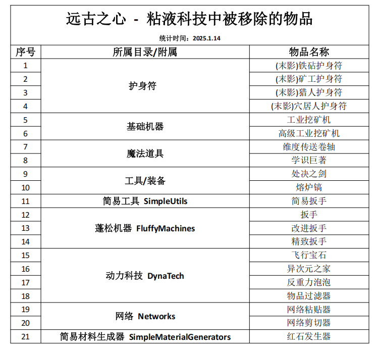

# 关于服务器修改

服务器针对原版规则、四季插件和粘液科技做了一些修改，具体如下。

::: tip 核对时间
本页按 2026 年 11 月 28 日服务器的实际配置整理。
:::

### 一、红石与机械

- **没有高频红石限制**：高频电路不会再被检测或拆除（原来的“每 30 秒最多 100 次脉冲”已取消）
- **没有红石元件数量限制**：活塞、黏性活塞、侦测器、漏斗、发射器、投掷器等每区块不限数量（原来的每区块上限已取消）
- **可以复制 TNT、地毯和铁轨**（活塞复制机）；无头活塞、破坏基岩等其他漏洞仍然无效
- 红石采用 Paper 的 **Alternate Current** 算法：普通电路和原版效果一样，但方块更新的顺序不同，依赖更新顺序的装置（部分 BUD、零刻电路）可能无法工作
- 漏斗搬运速度和原版相同（每 8 刻 1 个，每秒 2.5 个），但从上方吸取物品的检查间隔是 8 刻（原版每刻检查），对时序要求很严的物流可能有差异
- 漏斗不会和埋在实心方块里的容器交互，例如藏在方块里的漏斗矿车
- 每刻最多处理 50 个 TNT，超出的顺延到下一刻
- 盔甲架不会被推动，也不受重力影响，依赖盔甲架物理效果的机关无法工作

### 二、生物

- **生物可以穿过地狱门和末地门**（原来的“生物禁止穿过地狱门”已取消）
- 每格最大实体挤压数量（maxEntityCramming）：

| 世界 | 数值 |
| :--: | :--: |
| 生存世界—地球、地狱、末路之地、主城 | **8** |
| 旧世界、资源世界 | 24（原版） |

- **幻翼**：生存世界—地球、旧世界—生存和主城不会生成；资源世界正常生成
- 自然刷怪上限（每位玩家）：怪物 **15**（原版 70），动物 **5**（原版 10），刷怪速度也比原版慢
- 模拟距离 **3 区块**：离玩家 3 个区块以外的生物和农作物不会运作
- 视距：**7 区块**

#### 生物数量限制

生物数量按 5×5 区块合并计算。达到上限后，这片区域不再生成该类生物；服务器每 5 分钟检查一次玩家附近，**超出上限的生物会被清除**。

| 分组 | 包含 | 上限（5×5 区块合计） |
| :--: | :--: | :--: |
| 动物 | 猪、牛、马、兔子、羊、鸡、铁傀儡 | 35 |
| 村民 | 村民 | 20 |
| 怪物 | 僵尸、骷髅、史莱姆、苦力怕、鱿鱼、尸壳、凋灵骷髅、猪灵、僵尸猪灵、女巫、灾厄村民等 | 25 |

部分生物另有单独上限，例如：村民 10，末影人、烈焰人、凋灵骷髅 15，猪、牛、羊、鸡 20，僵尸、骷髅、苦力怕、蜘蛛、史莱姆 30，蜜蜂 60。

**不受清理**：命名过的、驯服的、幼年的、装了鞍的动物，捡起过物品的生物，放满物品的盔甲架和物品展示框。

### 三、掉落物清理

| 掉落物 | 消失时间 |
| :--: | :--: |
| 普通掉落物 | **3 分钟**（原版 5 分钟） |
| 圆石、石头、深板岩、泥土、草方块、沙子、红沙、沙砾、砂岩、下界岩、安山岩、闪长岩、花岗岩、凝灰岩、方解石 | **20 秒** |
| 各种树叶和树苗、甘蔗、竹子、仙人掌、海带、西瓜片、南瓜、矮草丛、腐肉 | **20 秒** |
| 脚手架 | 30 秒 |
| 玩家射出的箭（非无限） | 1 分钟 |
| 无限附魔或创造模式射出的箭、生物射出的箭 | 1 秒 |

- 掉落物在 3.5 格内会合并成一堆，经验球在 4 格内合并
- 用水流收集基础方块时，请让它们在 20 秒内进入漏斗或容器

### 四、挖矿

- 在**旧世界—生存**和**生存世界—地球**挖矿石**不会掉落矿物**（煤、铁、铜、金、红石、绿宝石、青金石、钻石，包括深层矿石），请前往**资源世界**开采
- 下界的矿石不受影响

### 五、因四季插件影响的内容

四季在旧世界—生存、生存世界—地球、资源世界和主城生效，这几个世界的日期和昼夜同步。下面是影响比较大的内容，更多信息见[四季](../reason/spring.md)。

| 季节 | 开始日期 | 户外作物生长速度 |
| :--: | :--: | :--: |
| 春天 | 3 月 4 日 | 1.2 倍 |
| 夏天 | 6 月 4 日 | **2 倍**（室内 1.4 倍） |
| 秋天 | 9 月 4 日 | 0.8 倍 |
| 冬天 | 12 月 4 日 | **不生长**（室内需持续亮度 8 以上的方块光照才正常生长） |

适用于小麦、甜菜、胡萝卜、马铃薯、西瓜、南瓜、竹子、可可豆、甘蔗、甜浆果、仙人掌和下界疣。

#### 春天

- 大量的羊、牛、猪、兔子和鸡会生成
- 蜜蜂会更多

#### 夏天

- 不会自然下雨
- 豹猫、熊猫、鹦鹉等丛林动物在各处生成
- 会生成尸壳而不是僵尸

#### 秋天

- 经常下雨和雷暴
- 狐狸、哞菇、蝙蝠、青蛙、洞穴蜘蛛和更多的蜘蛛出现
- 生物有 20% 几率头戴南瓜

#### 冬天

- 经常下雪
- **地面不会积雪，水面也不会结冰**（树叶上仍会积雪）
- 户外植物和作物不会生长
- 狼、狐狸、北极熊和雪傀儡出现，会生成流浪者而不是骷髅

### 六、关于粘液科技的修改

- 每区块货运节点数量：**96 个**

- #### 全自动收集机

全自动收集机新增了以下产出。附近需要对应的**成年**生物，按数量消耗原料。

| 原料 | 产出 | 需要在附近的生物 |
| :--: | :--: | :--: |
| 海草 ×10 | 海龟鳞甲 | 海龟 |
| 小麦种子 ×10 | 生鸡肉 | 鸡 |
| 糖 ×10 | 鸡蛋 | 鸡 |
| 线 ×5 | 羽毛 | 鸡 |
| 鸡蛋 ×1 | 生鸡肉 | 鸡 |
| 燧石 ×1 | 腐肉 | 僵尸 |
| 腐肉 ×4 | 皮革 | 马 |
| 燧石 ×2 | 蜜脾 | 蜜蜂 |
| 玻璃瓶 ×1 | 蜂蜜瓶 | 蜜蜂 |
| 小麦 ×10 | 生牛肉 | 牛 |
| 铁块 ×5 | 基础电路板 | 铁傀儡 |
| 蒲公英 ×10 | 生兔肉 | 兔子 |
| 胡萝卜 ×10 | 兔子脚 | 兔子 |
| 皮革 ×4 | 兔子皮 | 兔子 |
| 小麦 ×10 | 生羊肉 | 羊 |
| 甜菜根 ×10 | 生猪排 | 猪 |
| 剪刀 | 同色羊毛 1~3 个（只消耗剪刀耐久，羊不会被剪秃） | 羊 |
| 幻翼膜 ×4 | 幽灵精华 | 恼鬼或唤魔者 |
| 合成蓝宝石 ×1 | 恼鬼宝石 | 恼鬼或唤魔者 |

原有的桶→牛奶（牛或山羊）、碗→蘑菇煲（哞菇）不变。

- #### 末影培育仓

末影培育仓放入 1 个下列方块，就会产出 64 个同样的方块（末影培育仓 MK2 产出 3 组）：

**圆石、石头、平滑石头、沙砾、沙子、玻璃、下界岩、灵魂沙、黑曜石、泥土、泥巴、草方块、灰化土、末地石、红石块、树脂块、16 色混凝土**

### 七、粘液科技中被移除的物品

